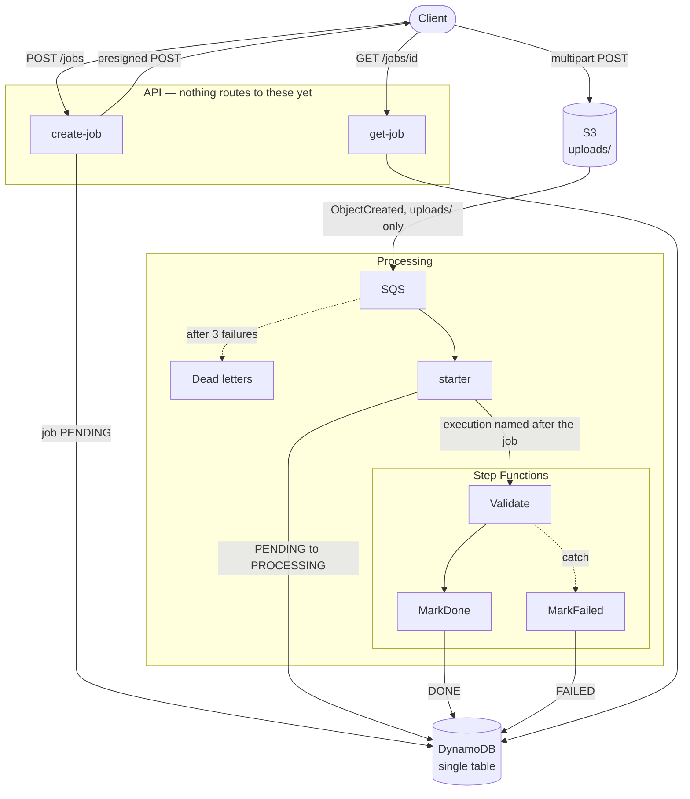
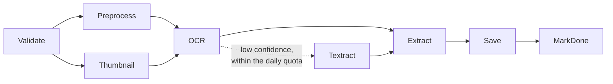
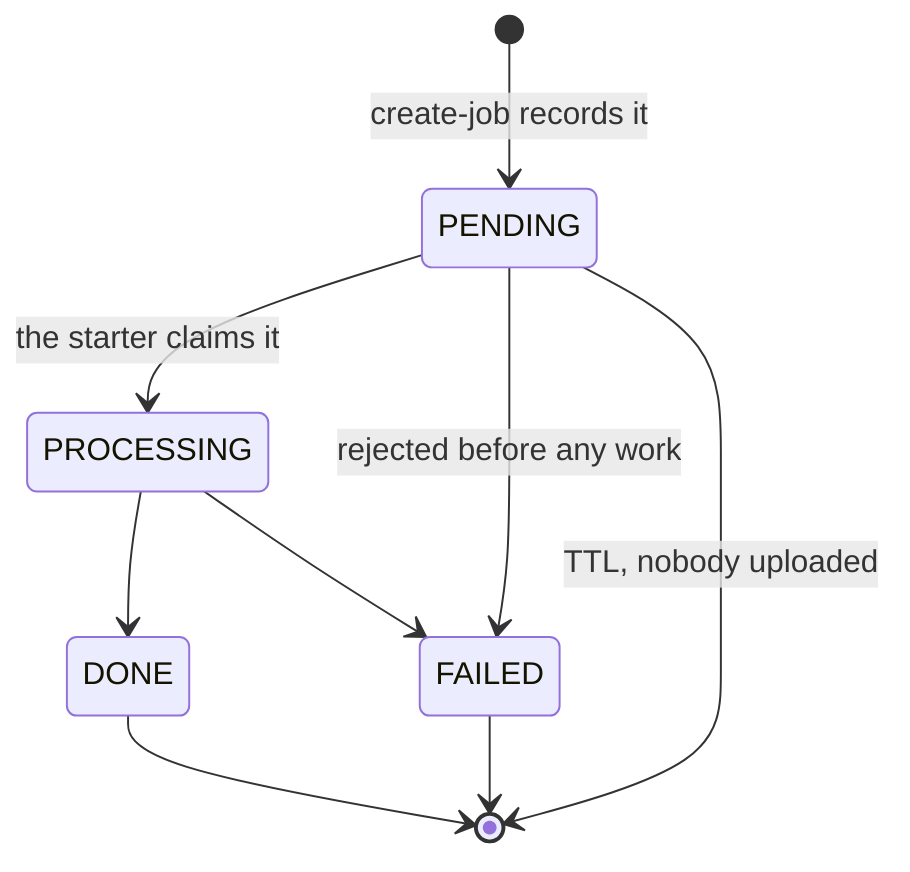

# Architecture

DocFlow accepts a document, recognizes its text, extracts fields from it, and
reports progress while it works. It is built to cost nothing when idle.

This document describes what exists. Where the design is not finished, it
says so rather than describing the intention as though it were the code.
`AGENTS.md` holds the constraints the design answers to; `docs/adr/` holds
the decisions that departed from them.

## Status

| Piece | State |
|---|---|
| Domain model, logging, persistence | implemented |
| Presigned uploads, the two API handlers | implemented |
| Infrastructure for everything below | implemented, **never deployed** |
| Upload queue, workflow starter, validation | implemented |
| Preprocess, thumbnail, OCR, extract | packages exist, no workflow states yet |
| HTTP API, authorizer | **not built**: the token issuer is undecided |
| Dashboard | not started |

Nothing has run on AWS. See [What is not verified](#what-is-not-verified).

## Flow

What runs today. Dashed edges are failure paths.

`create-job` and `get-job` have no route in front of them yet. The workflow
ends after validation.

### Where the rest goes

The recognition packages are written and tested but have no states. This is
the shape they slot into, not code that exists:

Preprocess and Thumbnail run in parallel. Every state is one billed
transition per job, which is what keeps the chain short; see
[Cost](#cost).

## Components

### Domain

`internal/model` holds the types every other package speaks in: `Job` and its
status machine, `StepResult`, `DocumentResult`, and `WorkflowInput`, the
payload that travels between workflow states. It also owns job id generation
(ULID), the content types each document kind accepts, and the upload size
cap. It depends on nothing.

Job ids are ULIDs because they sort by creation time. That is what lets a
user's jobs be listed newest-first by reading sort keys backwards, with no
secondary index.

### Persistence

`internal/store` is the single DynamoDB table, behind a `JobStore`
interface. `internal/quota` writes the daily counter into the same table but
owns those items; it builds its keys from helpers `store` exports, so the
layout lives in one place.

| PK | SK | Holds |
|---|---|---|
| `USER#<id>` | `JOB#<ulid>` | the job: status, keys, timestamps |
| `USER#<id>` | `QUOTA#<yyyy-mm-dd>` | paid OCR pages used that UTC day |
| `JOB#<id>` | `STEP#<name>` | one step's outcome, duration, error |
| `JOB#<id>` | `RESULT` | recognized text and extracted fields |

Every item carries `expiresAt`, a Unix timestamp seven days out, and the
table's TTL is configured on that attribute. Jobs, their steps, their
results, and the uploaded bytes all expire together.

Nothing scans. Listing a user's jobs is a query on their partition, so one
user's volume never affects another's read cost. There is no secondary
index, and adding one needs a record here.

### Storage

`internal/storage` hands out presigned uploads and reads objects back.
Uploads are a presigned **POST**, not a PUT, because only a POST carries a
policy and only a policy can bound the body size. The size limit and the
content type are signed into it, so S3 refuses an oversized or mistyped body
before it costs anything.

### API

`internal/api` holds the request handling; `cmd/create-job` and
`cmd/get-job` build clients during initialization and start the runtime.

The caller comes from a JWT authorizer's verified `sub` claim, never from
anything the client sends, and is checked against the same rules a stored
job's owner is.

Ownership needs no permission check. A job lives under its owner's partition
key, so another user's id does not find it, and a caller cannot learn whether
someone else's job exists.

### Processing

`internal/pipeline` holds each workflow step's logic; the commands under
`cmd/` are thin. Steps exchange a `State`: identifiers and S3 keys, never
file contents.

- **starter** turns an upload event into a running execution.
- **validate** recognizes the document from its leading bytes.
- **finish** records the terminal status, on both the success and the catch
  path.

The recognition packages — `internal/preprocess`, `internal/ocr`,
`internal/extract` — exist in varying states and have no workflow states yet.

## The job lifecycle

Every move is a conditional write pinned to the expected current status, so
two workers racing cannot both win. A job never moves backwards and the
terminal states are terminal. Failing straight from `PENDING` is deliberate;
[ADR 0001](adr/0001-job-status-transitions.md) records why.

A job nobody uploads for stays `PENDING` until its TTL removes it. Nothing
fails it.

## Failure handling

Failures are one of two kinds, and the difference decides whether the
workflow backs off or gives up.

| Kind | Example | What happens |
|---|---|---|
| Permanent | the file is not a document | caught at once, job `FAILED` |
| Transient | the table throttled the write | three retries, exponential, jittered, then caught |

The Lambda runtime reports a returned error's bare Go type name, so
`PermanentError` and `TransientError` appear verbatim in the state machine's
rules. The retry rule names only the transient one. A test pins both names
with reflection, because renaming a type would otherwise stop the rules
matching with nothing failing.

What a user is told is decided in Go, not in the state machine definition. A
permanent failure's message was written by this code and names a step and a
cause, so it can be repeated. A transient one carries whatever AWS said and
may name a table, so only the fact of it travels.

## Idempotency

S3 events and SQS deliveries both repeat, so every write is keyed on the job
id and safe to apply twice.

| Where | How |
|---|---|
| `create-job` | writes under `attribute_not_exists`, so a retry cannot overwrite |
| starter, status | conditional write; a redelivery finds `PROCESSING` and carries on |
| starter, execution | the execution is named after the job, so Step Functions refuses a duplicate |
| step results | written without a condition, so a retried step overwrites its own attempt |
| finish | a conflict means something already finished the job, which is success |

The starter discards a message it cannot use rather than failing it.
Redelivering would produce the same result until the dead-letter queue filled
with noise. Messages that fail for a reason worth retrying are reported
individually, so one bad upload does not force SQS to redeliver the batch
beside it.

## Security

- **Clients never hold credentials for the bucket.** They get a presigned
  POST that expires in fifteen minutes, names one key, and carries the size
  and type limits in its signed policy.
- **A declared content type proves nothing.** `internal/validation` reads the
  object's leading bytes and rejects a file whose contents disagree with what
  the client said. A signature has to start the file, which refuses one
  format hidden behind another.
- **Decoding is bounded before it begins.** A few kilobytes of PNG can
  describe a gigapixel image, so declared dimensions are checked, with
  division rather than multiplication so a hostile header cannot overflow the
  check.
- **One IAM role per function, written statement by statement** rather than
  taken from the CDK's `Grant*` helpers, which hand over more verbs than any
  of these functions use. `create-job` can write one object under
  `uploads/*`, which is exactly the permission it signs into the upload
  policy: it cannot hand a client more than it holds.
- **Separation of duties is asserted, not assumed.** Tests require that
  production grants no wildcard action or resource, and that nothing can both
  read a customer's document and finish their job.
- **Errors do not leak internals.** Handlers log the cause and return a
  message; a table name or a bucket name never reaches a client. Presigned
  URLs are logged only through a redactor that strips the query string, where
  the signature lives.

## Cost

Nothing in the stack bills while idle. Two settings are the reason, and
neither is a default:

- The table bills per request. Provisioned capacity would bill at rest.
- Log groups expire after a week. A group with no retention keeps everything
  forever, and that is the bill that grows on its own.

| Service | Free tier | Shape here |
|---|---|---|
| DynamoDB | 25 GB | on-demand, items expire after 7 days |
| S3 | 5 GB | uploads expire after 7 days |
| Lambda | 1M requests | arm64, small memory, short timeouts |
| SQS | 1M requests | one message per upload |
| Step Functions | **4,000 transitions/month** | the binding limit |
| CloudWatch Logs | 5 GB | one week of retention |

Step Functions is the constraint worth watching. Each state is one billed
transition per job, so the workflow is kept short on purpose. At three states
that is roughly 1,300 jobs a month; the full pipeline will be closer to
eight, or about 500.

A test asserts the stack creates no NAT gateway, VPC, RDS instance,
OpenSearch domain, ElastiCache cluster, or ECS service, so the constraint is
checked rather than remembered.

The one recurring cost still to come is ECR, when the OCR function ships as a
container image carrying Tesseract and poppler: roughly 400 MB against a
500 MB free tier that lasts twelve months.

## Environments

Two stages, chosen with `-c stage=`:

| | dev | prod |
|---|---|---|
| Removal policy | destroy | retain |
| Bucket on teardown | emptied by a helper | kept |
| Log level | debug | info |

The account and region come from the ambient AWS configuration. No account
id is committed.

## What is not verified

Everything above is checked by unit tests, `cdk synth`, and assertions
against the synthesized template. **No part of it has run on AWS.** That
leaves a real gap:

- whether an S3 event actually reaches the queue
- whether the IAM policies are *sufficient*, as opposed to being what the
  code says they are
- whether an arm64 `provided.al2023` function bootstraps
- whether Step Functions passes payloads in the shape the steps expect
- whether the conditional writes behave as expected against a real table

The first and second can only be answered by a deployment. The others can be
answered locally, with DynamoDB Local, MinIO, and Step Functions Local; none
of that is set up yet, and there is no `make test-int` target despite
`AGENTS.md` mentioning one.

## Open decisions

| Question | Blocks |
|---|---|
| Which issuer signs the JWTs | the HTTP API, and therefore any real use |
| testcontainers-go or docker compose | integration tests against real servers |
| Whether CI enforces a coverage floor | nothing, but a gap already slipped through once |
